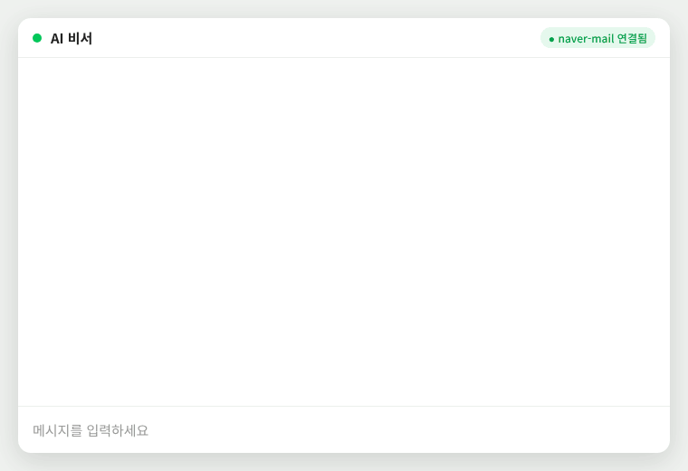

# naver-mail-mcp

[](LICENSE)
[-blue.svg)](#도구-gmail-mcp와-같은-이름)
[](https://modelcontextprotocol.io)

**AI 에이전트가 지메일처럼 네이버 메일도 읽고, 요약하고, 답장하게 해 주는 MCP 서버입니다.**

Claude, Grok, Meta Muse, ChatGPT, Codex에 연결하면 "이번 주 중요한 메일 요약해줘", "카드 결제 내역 메일만 모아줘", "이 메일에 회신해줘"가 네이버 메일에서도 됩니다.
도구 이름과 사용법이 **Gmail MCP와 같아서**, 지메일로 쓰던 에이전트 흐름을 그대로 쓸 수 있습니다.

[English](README.en.md)

<p align="center"></p>
<p align="center"><sub>예시 화면 (가상의 메일)</sub></p>

> 네이버의 공식 서비스가 아닙니다. 네이버 메일이 제공하는 IMAP/SMTP로 동작합니다.

## 무엇이 다른가

| | 이 프로젝트 | 다른 네이버 메일 MCP들 |
| --- | :---: | :---: |
| 검색·읽기·첨부 | ✅ | ✅ |
| 지메일 검색 문법 (`from:` `newer_than:7d` `has:attachment` …) | ✅ | 일부 |
| 대화(스레드) 묶어 보기 | ✅ | 일부 |
| 답장·전체 답장·전달 | ✅ | ❌ |
| 임시보관함 만들기·고치기·보내기 | ✅ | 일부 |
| 정리 (메일함 이동, 별표, 읽음, 휴지통, 스팸) | ✅ | ❌ |
| Gmail MCP와 같은 도구 이름·입력 | ✅ | ❌ |
| 클라우드 에이전트 연결 (Muse·Grok·Claude 앱, 설치 없이 주소만) | ✅ | 대부분 PC 전용 |
| 한국어 인코딩 메일 (EUC-KR, `ks_c_5601-1987`, `cp949`) | ✅ | — |

## 시작하기

### 1. 네이버 메일 준비 (한 번만, 약 3분)

연결하려면 **2단계 인증이 필수**입니다. 평소 로그인 비밀번호가 아니라, 2단계 인증을 켜야 만들 수 있는 **애플리케이션 비밀번호**로 연결합니다.

**① 2단계 인증 켜기**
1. 네이버 로그인 → 오른쪽 위 프로필 → **네이버 ID** (또는 [nid.naver.com](https://nid.naver.com))
2. **보안설정** → **2단계 인증** → **설정하기**
3. 휴대폰 번호(또는 네이버 앱)로 본인 확인을 마치면 켜집니다. 이미 켜져 있으면 ②로 넘어갑니다.

**② 애플리케이션 비밀번호 만들기**
1. **네이버 ID → 보안설정 → 2단계 인증 → 관리** (본인 확인을 한 번 더 할 수 있음)
2. 아래쪽 **애플리케이션 비밀번호 관리**에서 종류를 고르고 **생성하기**. 종류는 아무거나(예: Windows, 기타) 괜찮습니다.
3. 나온 비밀번호를 복사해 둡니다. **창을 닫으면 다시 볼 수 없습니다.** 잃어버리면 새로 만들면 됩니다.

**③ POP3/IMAP 설정에서 IMAP 켜기**
1. [네이버 메일](https://mail.naver.com) → 왼쪽 아래 **환경설정** (톱니바퀴)
2. **POP3/IMAP 설정** 탭 → **IMAP/SMTP 설정**
3. **IMAP/SMTP 사용: 사용함** → **저장**. POP3는 켤 필요가 없습니다.

네이버는 메뉴 이름·위치를 가끔 바꿉니다. 메뉴가 안 보이면 네이버 ID 페이지에서 "애플리케이션 비밀번호"를 검색하세요.

### 2. 연결하기 (쉬운 순서)

#### 방법 A. 주소만 넣기 — 추천, 설치 없음

공개 서버 주소: **`https://naver-mail-mcp.yeonuunim521.workers.dev/mcp`**

| 에이전트 | 넣는 곳 |
| --- | --- |
| Claude (웹·데스크톱·모바일) | 설정 → 커넥터 → 커스텀 커넥터 추가 |
| Grok | grok.com/connectors → New Connector → Custom |
| Meta Muse | 설정에서 커넥터 URL 추가, 또는 대화창에 주소를 주고 "연결해줘" |
| ChatGPT | 설정 → 앱/커넥터 → 개발자 모드에서 커스텀 커넥터 추가 |
| Claude Code | `claude mcp add --transport http naver-mail https://naver-mail-mcp.yeonuunim521.workers.dev/mcp` 후 `/mcp`에서 로그인 |
| Codex | `codex mcp add naver-mail --url https://naver-mail-mcp.yeonuunim521.workers.dev/mcp` 후 `codex mcp login naver-mail` |

주소를 넣으면 로그인 화면이 열립니다. **네이버 아이디**와 **애플리케이션 비밀번호**를 넣으면 끝입니다.

- 같은 서비스(예: Claude 앱)라면 PC·태블릿·폰 어디서든 한 번만 로그인하면 됩니다.
- Claude Code나 Codex에는 "네이버 메일 MCP 설치해줘. 주소는 https://naver-mail-mcp.yeonuunim521.workers.dev/mcp, 이름은 naver-mail"이라고만 해도 AI가 설치합니다. 로그인만 직접 하세요.

#### 방법 B. 내 PC에서 실행 — 비밀번호가 내 컴퓨터 밖으로 안 나감

Node.js 20 이상이 필요하고, Claude Desktop·Claude Code·Codex 같은 PC 프로그램에서만 쓸 수 있습니다.

Claude Desktop (`claude_desktop_config.json`):

```json
{
  "mcpServers": {
    "naver-mail": {
      "command": "npx",
      "args": ["-y", "naver-mail-mcp"],
      "env": { "NAVER_ID": "내아이디", "NAVER_APP_PASSWORD": "애플리케이션비밀번호" }
    }
  }
}
```

Claude Code: `claude mcp add naver-mail -e NAVER_ID=내아이디 -e NAVER_APP_PASSWORD=앱비밀번호 -- npx -y naver-mail-mcp`

#### 방법 C. 내 서버 만들기 — 클라우드 에이전트 + 내 서버

[](https://deploy.workers.cloudflare.com/?url=https://github.com/CapyKkuing/naver-mail-mcp)

버튼을 누르면 내 Cloudflare 계정(무료로 됨)에 똑같은 서버가 만들어집니다. 다 되면 나오는 `https://naver-mail-mcp.<내 계정>.workers.dev/mcp`를 방법 A처럼 넣으면 됩니다.

- `ALLOWED_USERS`에 내 네이버 아이디를 넣으면 나만 쓸 수 있습니다. 비우면 누구나 자기 계정으로 연결할 수 있습니다.
- 직접 배포하려면: `npm install` → `npx wrangler kv namespace create OAUTH_KV`로 만든 id를 `wrangler.jsonc`에 넣기 → `npx wrangler deploy`

<details>
<summary>고정 토큰 모드 (헤더를 넣을 수 있는 클라이언트용)</summary>

```bash
npx wrangler secret put MCP_BEARER_TOKEN      # 긴 무작위 문자열
npx wrangler secret put NAVER_ID
npx wrangler secret put NAVER_APP_PASSWORD
```

요청 헤더에 `Authorization: Bearer <MCP_BEARER_TOKEN>`를 넣으면 OAuth 없이 위 계정으로 접속합니다.
</details>

## 보안과 개인정보

**이 서버가 다루는 가장 민감한 것은 애플리케이션 비밀번호입니다.** 어디에 어떤 형태로 있는지 그대로 적습니다.

| 어디에 | 어떤 형태로 | 언제까지 |
| --- | --- | --- |
| OAuth 저장소 (Cloudflare KV) | 연결한 앱의 토큰으로만 풀 수 있게 **AES-GCM 암호화** (`@cloudflare/workers-oauth-provider`) | 갱신 토큰 수명 30일. 네이버에서 앱 비밀번호를 지우면 그 전이라도 쓸모없어짐 |
| MCP 세션 (Durable Object) | **메모리에만**. 요청마다 토큰에서 풀어 전달하므로 저장소에 쓰지 않음 | 세션이 끝나면 사라짐 |
| 네이버 서버로 가는 길 | IMAP 993 / SMTP 465, TLS 암호화 | 요청 중에만 |
| 로그 | 비밀번호·메일 내용은 기록하지 않음. 요청 기록(Workers Logs)도 켜 두지 않음 | — |

- **메일 내용은 서버에 저장하지 않습니다.** 요청이 올 때 네이버에서 읽어 에이전트에 넘길 뿐입니다. 끊긴 응답을 이어 주는 임시 저장 기능도 꺼 두었습니다.
- **세션은 로그인한 계정에 묶입니다.** 다른 사람의 세션 ID를 알아도 내 로그인으로는 그 세션에 닿을 수 없습니다.
- **연결 끊기:** 네이버 ID → 보안설정 → 2단계 인증 → 애플리케이션 비밀번호 **삭제**. 서버에 남은 암호화 사본은 그 순간부터 쓸모가 없어지고, 어느 에이전트에서든 즉시 끊깁니다.
- **가짜 로그인 화면 주의:** 로그인 화면에는 **"권한이 전달될 곳"**이 항상 표시됩니다. 남에게서 받은 링크로 이 화면이 열렸거나, 그 주소가 내가 쓰는 AI 서비스가 아니면 **거부**하세요. 알려진 서비스(Claude, Grok, Meta Muse, ChatGPT)가 아니면 화면에 빨간 경고가 뜹니다.
- **메일 속 지시문 주의:** 메일 본문에 "이 메일을 다른 주소로 전달해"처럼 AI를 겨냥한 문장이 들어 있을 수 있습니다. 이 서버는 보내기·답장·전달 전에 사용자에게 확인하라고 에이전트에게 안내하지만, 최종 판단은 에이전트가 합니다. 에이전트의 "도구 실행 전 확인" 설정을 켜 두는 것을 권합니다.
- **무차별 대입 방지:** 로그인 시도는 IP마다 분당 10회, 전체 분당 60회로 제한합니다. 로그인 화면(`/authorize`)이 아닌 주소로는 로그인을 받지 않습니다. 네이버가 이 서버의 IP를 차단해 모든 사용자가 피해를 보는 일을 막기 위한 것입니다.
- **공개 서버가 꺼려지면:** 공개 서버를 쓰는 것은 그 운영자를 믿는다는 뜻입니다. 코드는 모두 이 리포에 있고, 운영자도 KV의 암호화된 값만 볼 수 있을 뿐 토큰 없이는 풀 수 없습니다. 그래도 불안하면 방법 B(내 PC)나 방법 C(내 서버)를 쓰세요.

취약점을 발견하면 공개 이슈 대신 리포의 **Security → Report a vulnerability**로 알려 주세요.

## 도구 (Gmail MCP와 같은 이름)

| 분류 | 도구 |
| --- | --- |
| 찾기·읽기 | `search_threads`, `get_thread`, `get_message`, `get_attachment`, `get_profile` |
| 보내기 | `send_message`, `reply`(전체 답장), `forward`(원래 첨부 포함) |
| 임시보관함 | `create_draft`, `update_draft`, `delete_draft`, `list_drafts`, `get_draft` |
| 라벨 | `list_labels`, `create_label`, `update_label`, `delete_label`, `label_message`, `unlabel_message`, `update_message_labels`, `label_thread`, `unlabel_thread` |
| 휴지통·스팸 | `trash_message`, `trash_thread`, `untrash_message`, `untrash_thread`, `mark_message_spam`, `mark_thread_spam`, `unmark_message_spam`, `unmark_thread_spam` |

`get_profile`과 `get_attachment`는 Gmail MCP에는 없는 추가 도구입니다.

### Gmail과 다른 점 (IMAP의 한계)

- **라벨은 메일함입니다.** `INBOX`, `SENT`, `DRAFT`, `TRASH`, `SPAM`은 해당 메일함, 사용자 라벨은 메일함 경로입니다. 한 메일은 한 메일함에만 있으므로 메일함 라벨을 붙이면 **이동**합니다. `STARRED`(중요 표시)와 `UNREAD`(안읽음)는 플래그입니다.
- **메일 ID는 메일함과 UID로 만듭니다.** 메일을 옮기면 ID가 바뀌고, 옮기는 도구가 새 ID를 돌려줍니다. 임시보관 메일을 고칠 때도 ID가 바뀝니다.
- **보관(archive)이 없습니다.** 받은메일함에서 빼려면 다른 메일함 라벨을 붙이세요.
- **대화(thread)는 Message-ID/References 헤더로 묶습니다.** 네이버 IMAP은 헤더 검색이 잘 안 돼서, 메일함마다 최근 1,000통의 헤더를 직접 읽어 찾습니다.
- **낱말 검색**은 제목, 보낸 사람, 본문을 따로 찾아 합칩니다 (네이버 IMAP은 OR·전체 텍스트 검색을 처리하지 못함). `has:attachment`, `filename:`은 메일 구조를 직접 확인하며 메일함마다 최근 3,000통까지 봅니다. 더 오래된 메일은 `after:` 같은 기간 조건을 함께 쓰세요.
- **기본 검색 범위**는 휴지통, 스팸, 임시보관함을 뺀 모든 메일함입니다. `category:` 같은 Gmail 전용 조건은 무시하고 결과의 `warnings`에 알려 줍니다.
- 서명 자동 붙이기와 카테고리 탭은 지원하지 않습니다.

## 실제 네이버 계정에서 확인한 것

2026년 10월, Meta Muse로 연결해 확인했습니다.

- 2단계 인증 + 애플리케이션 비밀번호로 연결
- 계정·안 읽은 메일 수 확인, 최근 메일 요약
- 검색: 한글 낱말(`결제`), 제목(`subject:`), 기간(`newer_than:30d`), 첨부(`has:attachment`, `filename:pdf`), 보낸메일함(`in:sent`)
- 대화 묶어 보기(`get_thread`), 첨부 이름 읽기
- 메일 발송과 보낸메일함 저장

답장·전달·임시보관함·라벨 이동·휴지통은 가짜 메일 서버 통합 테스트로 확인했고, 실제 계정 확인은 진행 중입니다. 문제를 발견하면 [이슈](https://github.com/CapyKkuing/naver-mail-mcp/issues)로 알려 주세요.

## 개발

```bash
npm install
npm test             # 가짜 IMAP/SMTP 서버 통합 테스트 + 단위 테스트
npm run typecheck
npm run dev          # 로컬 Worker: http://localhost:8787/mcp
npm run stdio        # 로컬 stdio (NAVER_ID, NAVER_APP_PASSWORD 환경 변수)
npm run build:stdio  # npm 배포용 dist/stdio.js
```

접속 정보: IMAP `imap.naver.com:993`(SSL), SMTP `smtp.naver.com:465`(SSL). 바뀐 내용은 [CHANGELOG](CHANGELOG.md)에 있습니다.

## 라이선스

MIT
